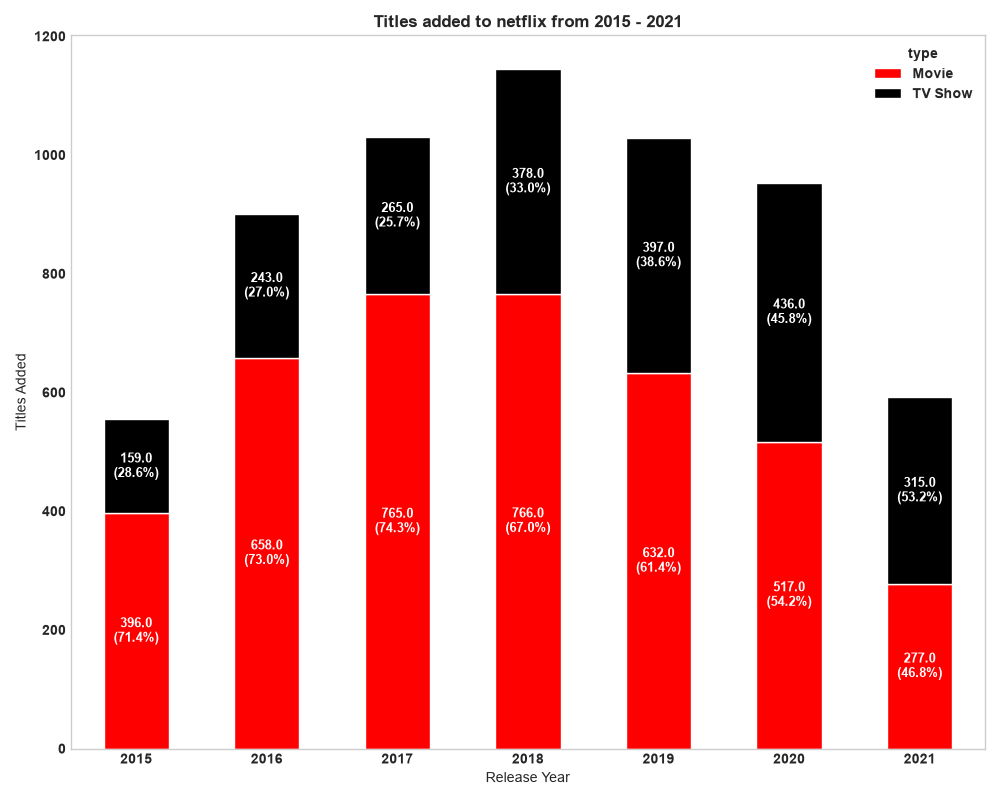
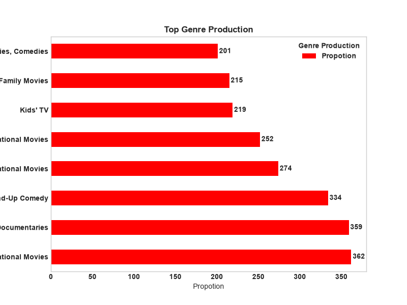
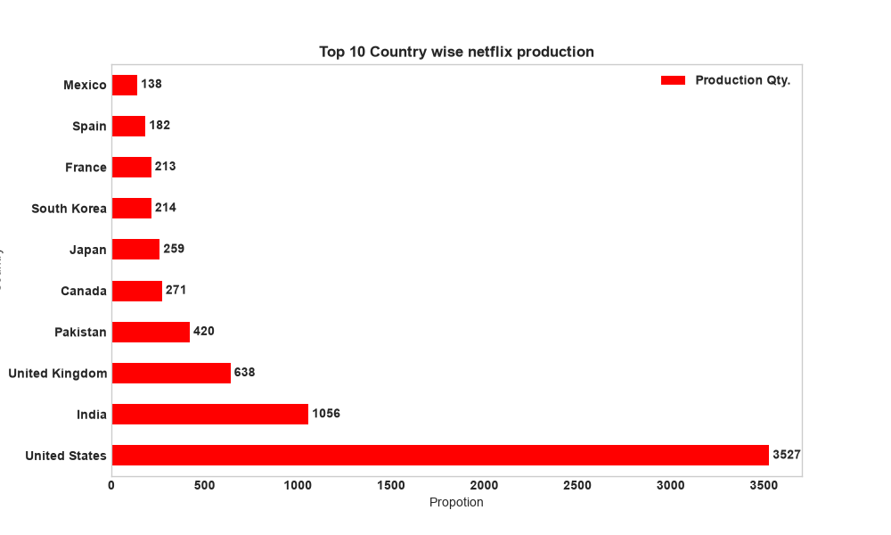
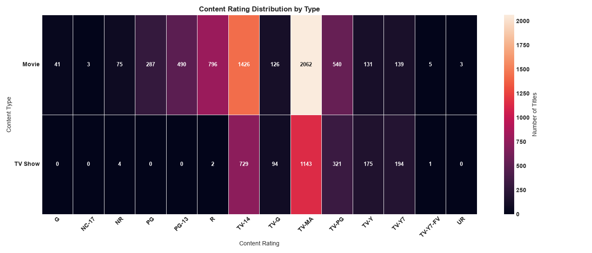

# Internship Report 

###### Aushpify Teachnology
---

<div align="center">


</div>

## Table of content

1. [Installation Guide](#1.-Installation)
2. [About The Project](#2.-About)
3. [Data Insights](#3.-Data-Insights)
   - [3.1 Content type distribution](#3.1-Content-Type-Distribution)
   - [3.2 Movie and TV shows shares](#3.2-Movie-and-TV-shows-shares)
   - [3.3 Title Propotion in Netflix](#3.3-Title-added-propotion)
   - [3.4 Top Genre Production](#3.4-Top-Genre-Production)
   - [3.5 Top Country Production title in netflix](#3.5-Top-country-title-production)
   - [3.6 Content Rating by the type](#3.6-Content-rating-by-type-distribution)


## 1. Installation

1. clone the repository in your local directory of your machine 

```code
git clone https://github.com/MohmmedFurqaan/netflix_eda.git
```

2. Let's setup the envinoment

In the project root directory, You will find the `project_config.yml` file. These file contains the envirnoment dependencies you can setup the envirnoment by the following :

```code 
conda env create -f project_config.yml
```

Then 

```code
conda activate netflix
```

## 2. About 

This project is an **Internship Report** focused on completing the assigned task by the organization. The data we have is about the netlfix data.

The project is built primarily to strengthen my understanding and practical implementation of the **Data Analytics using Python**, including exploratory data analysis as well as shipping up the quality report to the organization mentor.


## 3. Data Insights

As mention in the task pdf, below is the report based on the given netflix data.


### 3.1 Content Type Distribution
> AS per my analysis i founded that there are **6124 Movies** (which is of 69% of cleaned dataset). Alongside there is about **2663 TV shows** (which is about 30% of cleaned dataset)


### 3.2 Movie and TV shows shares
> Below graph shows about how many season for TV shows and how much duration of the movies is there in the dataset.


### 3.3 Title added propotion
> Based on the below graph we can clearly says that most **title added is in the year 2018 for the movie** while **Most added TV Shows is in 2020**.



### 3.4 Top Genre Production
> From the below graph, it is concluded that the **top genre produced up by the netflix is of Dramas Internation Movies which is 362** among all the other genres. 



### 3.5 Top country title production 
> Based on the below graph, **USA** is the most leading country producing around the *3527* title in the netflix.



### 3.6 Content rating by type distribution
> Based on the below heatmap, the findings are in the tabel

| Key Finding | Movies | TV Shows |
|---|---|---|
| Most Common Rating | TV-MA (2,062) | TV-MA (1,143) |
| Second Most Common Rating | TV-14 (1,426) | TV-14 (729) |
| Adult-oriented Ratings (R) | 796 | 2 |
| Family / Children-oriented Ratings (TV-Y, TV-Y7, TV-G) | 395 | 463 |
| Other Notable Rating | PG-13 (490) | TV-PG (321) |

