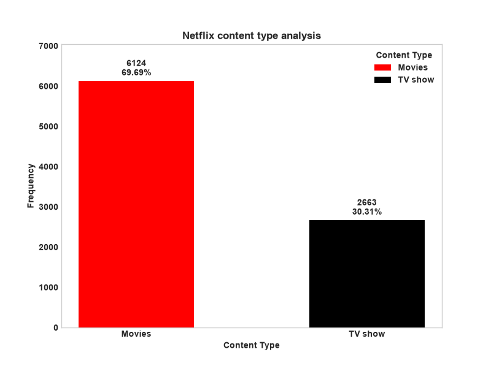
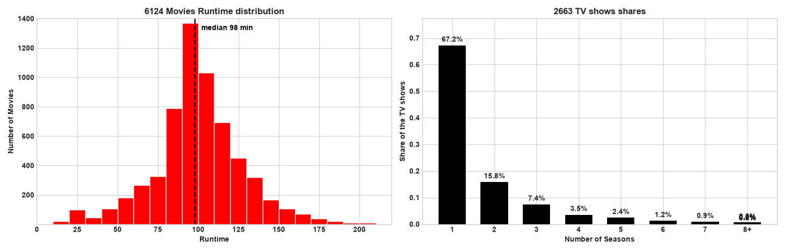

# Internship Report 

###### Aushpify Teachnology
---

<div align="center">


</div>

## Table of content

1. [Installation Guide](#1.-Installation)
2. [About The Project](#2.-About)
3. [Data Insights](#3.-Data-Insights)
   - [3.1 Content type distribution](#3.1-Content-Type-Distribution)
   - [3.2 Movie and TV shows shares](#3.2-Movie-and-TV-shows-shares)


## 1. Installation

1. clone the repository in your local directory of your machine 

```code
git clone https://github.com/MohmmedFurqaan/
```

2. Let's setup the envinoment

In the project root directory, You will find the `project_config.yml` file. These file contains the envirnoment dependencies you can setup the envirnoment by the following :

```code 
conda env create -f project_config.yml
```

Then 

```code
conda activate netflix
```

## 2. About 

This project is an **Internship Report** focused on completing the assigned task by the organization. The data we have is about the netlfix data.

The project is built primarily to strengthen my understanding and practical implementation of the **Data Analytics using Python**, including exploratory data analysis as well as shipping up the quality report to the organization mentor.


## 3. Data Insights

As mention in the task pdf, below is the report based on the given netflix data.


### 3.1 Content Type Distribution
> AS per my analysis i founded that there are **6124 Movies** (which is of 69% of cleaned dataset). Alongside there is about **2663 TV shows** (which is about 30% of cleaned dataset)



### 3.2 Movie and TV shows shares
> Below graph shows about how many season for TV shows and how much duration of the movies is there in the dataset.


